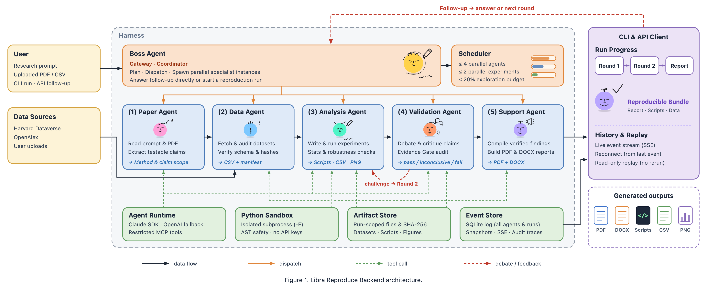

# Libra Reproduce Backend — Pure-Backend Multi-Agent Scientific Paper Reproduction Harness

`libra-reproduce-backend` is a standalone, **harness-engineered multi-agent LLM framework** for empirical scientific paper reproduction. Designed specifically for **Project 2 (T1 — Paper Reproduction)** of the Coding / Design Test, it automates data auditing, sandboxed Python experimentation, cross-agent methodological debate, counterfactual robustness checks, independent verification (`EvidenceGate`), and publication-ready **PDF & Word (`.docx`) report generation**—without any frontend dependency.

---

## System Architecture Figure (Part II Design Test — Option A)



- Vector PDF: [`design/project2_system_architecture.pdf`](design/project2_system_architecture.pdf)
- Editable Vector SVG: [`design/project2_system_architecture.svg`](design/project2_system_architecture.svg)
- Design docs & contracts: [`docs/IMPLEMENTATION_STATUS.md`](docs/IMPLEMENTATION_STATUS.md) · [`docs/decisions/ADR-V2-01-to-07.md`](docs/decisions/ADR-V2-01-to-07.md) · [`contracts/openapi.yaml`](contracts/openapi.yaml)

---

## 1. Target Paper & Prompt

- **Target Paper**: Lingfei Wu, Dashun Wang & James A. Evans (2019), *"Large teams develop and small teams disrupt science and technology"*, **Nature**, 566, 378–382 (`https://www.nature.com/articles/s41586-019-0941-9`, DOI `10.1038/s41586-019-0941-9`).
- **Example Prompt**: `"How does team size influence the balance between disruptive innovation and developmental research in science and technology?"`
- **Primary Empirical Cohort (`data/samples/`)**:
  - `wu2019_mag_stratified_sample.csv.gz` (`N = 60,120` rows; `45,335` in `1954–2014` primary historical cohort and `14,785` in `2015–2021` right-truncated regime) sampled deterministically via HTTP `206 Range` slices from the authors' Harvard Dataverse release (`https://doi.org/10.7910/DVN/JPWNNK`, File `6925921` `Aggregated_20210521.txt`, License **`CC0-1.0`**).
  - `wu2019_s2_openalex_bounded.csv` — bounded OpenAlex citation neighborhood (`5y` vs. `10y` observation windows) used for independent graph-level recomputation $D = (n_i - n_j)/(n_i + n_j + n_k)$ (`Level S2`).
  - Provenance details: [`data/README.md`](data/README.md).

---

## 2. Harness Architecture & Multi-Agent Roles

1. **`BossAgentGateway` (`libra_reproduce/harness/main_gateway.py`)**:
   - Sole command gateway (`POST /api/runs/{run_id}/chat`) enforcing `(run_id, request_id)` idempotency, separating zero-cost read-only inquiries (`200 OK`, `status: "answered"`) from orchestrated reproduction jobs (`202 Accepted`), and rejecting over-budget exploration requests (`> 20%`).
2. **Dynamic Multi-Instance Persona Catalog (`libra_reproduce/harness/persona_catalog.py`)**:
   - Six baseline role classes (`Boss`, `Paper`, `Data`, `Analysis`, `Validation`, `Support`) decoupled from on-demand `runtime_agent_id` sessions, plus dynamic parallel specialist spawning (`Analysis #2`, `Analysis #3`, `Data #2`, `Validation #2`, etc.).
3. **Controlled `SDKAdapter` (`libra_reproduce/harness/sdk_adapter.py`)**:
   - **Primary live backend**: **`claude-agent-sdk==0.2.189`** (`ClaudeSDKClient`) exposing restricted in-process MCP tools (`create_sdk_mcp_server("science", ...)`), blocking unrestricted `Bash`/`Write`/`Edit`/`Read`/`Task`/`Agent`, and logging secret-redacted `tool.executed` traces.
   - **Portable live fallback**: OpenAI-compatible tool-calling loop (`LLM_API_KEY`, `LLM_BASE_URL`, `LLM_MODEL`) governed by the exact same `ToolPermissionGate` and `ResourceScheduler`.
   - **Deterministic offline CI fixture**: `mode="simulation"` (explicitly tagged `simulation` across all events and snapshots).
4. **Dual-Pool `ResourceScheduler` (`libra_reproduce/harness/scheduler.py`)**:
   - Enforces independent concurrency caps (`max_active_agent_tasks = 4`, `max_parallel_experiments = 2`) and exploration budget cap (`exploration_budget_fraction <= 0.20`), releasing leases deterministically on failure or cancellation.
5. **Isolated `SafeExperimentRunner` (`libra_reproduce/security/experiment_runner.py`)**:
   - Performs static AST validation (blocking network imports, subprocesses, `os.environ` access, and writes outside the run workspace) and executes generated Python scripts inside `python -E` isolated subprocesses with stripped environments (`0` API keys) and timeouts.
6. **Methodological Debate -> Counterfactual Pod -> `EvidenceGate` (`libra_reproduce/harness/collaboration_manager.py`, `libra_reproduce/science/evidence_gate.py`)**:
   - `Validation` challenges forward citation-window truncation and functional-form stability (`collaboration.started`), expanding with `Data` and `Analysis` instances into a sensitivity & falsification Pod (`collaboration.members_changed`) that executes Round 2 econometric & simulation checks + live agent-authored falsification trials before `EvidenceGate` audits SHA-256 hashes, sample $N$ conservation, PNG headers, and honest `S1` vs. `S2` boundaries.
7. **Transactional `EventStore` & `ReportBuilder` (`libra_reproduce/storage/event_store.py`, `libra_reproduce/science/report_builder.py`)**:
   - Persists monotonic `(run_id, seq)` `HarnessEvent` ledgers in SQLite supporting `Last-Event-ID` / `?after=N` resumable SSE streams and zero-execution historical snapshots (`GET /api/runs/{run_id}/snapshot?at_seq=N`).
   - Compiles readable **PDF (`reproduction_report.pdf`)** and **Word (`reproduction_report.docx`)** reports embedding publication-grade Matplotlib figures, statistical tables, Research Gains (`Verified`, `Ruled Out`, `Open Questions`, `Method Notes`), and reproduction commands.

---

## 3. Setup & Dependencies

### Prerequisites
- Python `>= 3.11` (tested with Python `3.13` / `3.14`)
- [`uv`](https://docs.astral.sh/uv/) (recommended) or standard `pip`

### Option A: Install with `uv` (Recommended)

```bash
git clone https://github.com/orwhd/Libra-Reproduce-Backend.git
cd Libra-Reproduce-Backend
uv sync
```

### Option B: Install with `pip` + `venv`

```bash
python3 -m venv .venv
source .venv/bin/activate
pip install -r requirements.txt
```

### Credentials Configuration (Live vs. Simulation)

```bash
cp .env.example .env
```

- **Live Mode with Claude Agent SDK (default when available)**: Ensure `claude` CLI is authenticated (`claude auth status`) or set `ANTHROPIC_API_KEY` in `.env`.
- **Live Mode with OpenAI-compatible API (DeepSeek / OpenAI)**: Set `LLM_API_KEY`, `LLM_BASE_URL`, and `LLM_MODEL` in `.env`.
- **Offline Simulation Mode (Zero API Key Required)**: Pass `--simulation` to CLI/scripts or `?mode=simulation` over HTTP.

---

## 4. How to Run & Reproduce

### A. One-Command Headless Reproduction (CLI)

```bash
# Live multi-agent reproduction -> writes PDF, DOCX, PNGs, CSVs, Python scripts & events.jsonl
uv run python scripts/reproduce_nature2019.py

# Or specify custom output directory & mode explicitly:
uv run python -m libra_reproduce.cli run \
  --paper-id paper_A \
  --mode live \
  --output-dir outputs/latest_run

# Deterministic zero-key simulation run:
uv run python scripts/reproduce_nature2019.py --simulation
```

### B. Re-Run the Exported Python Experiment Scripts Directly

Every statistical finding and figure in `outputs/nature2019_live_verified/` can also be executed standalone from disk:

```bash
mkdir -p /tmp/recheck_s1 /tmp/recheck_r2
uv run python outputs/nature2019_live_verified/reproduce_nature2019_experiment.py \
  outputs/nature2019_live_verified/wu2019_mag_sample.csv /tmp/recheck_s1
uv run python outputs/nature2019_live_verified/exp_round2_counterfactual_simulation.py \
  outputs/nature2019_live_verified/wu2019_mag_sample.csv /tmp/recheck_r2
```

### C. Standalone OpenAPI 3.1 HTTP + Resumable SSE Server

```bash
uv run uvicorn libra_reproduce.main:app --host 127.0.0.1 --port 8001
```

Example HTTP workflow:

```bash
# 1. Create run (6 idle personas, 0 LLM calls before user command)
RUN_ID=$(curl -s -X POST "http://127.0.0.1:8001/api/runs?mode=live" \
  -H "Content-Type: application/json" \
  -d '{"title":"Nature 2019 Reproduction","paper_id":"paper_A"}' | python3 -c "import sys,json; print(json.load(sys.stdin)['run_id'])")

# 2. Submit command to Boss Agent
curl -s -X POST "http://127.0.0.1:8001/api/runs/$RUN_ID/chat" \
  -H "Content-Type: application/json" \
  -d '{"request_id":"req_001","text":"How does team size influence the balance between disruptive innovation and developmental research in science and technology?"}'

# 3. Stream ordered HarnessEvents via SSE (supports ?after=N or Last-Event-ID)
curl -N "http://127.0.0.1:8001/api/runs/$RUN_ID/events?after=0"

# 4. Inspect read-only snapshot & generated PDF/DOCX reports
curl -s "http://127.0.0.1:8001/api/runs/$RUN_ID/snapshot"
curl -s "http://127.0.0.1:8001/api/runs/$RUN_ID/report"
```

---

## 5. Verified Live Run Results (`rep_2212a8f80c7f`)

Executed live via `claude-agent-sdk==0.2.189` (`106` transactional events, `EvidenceGate = PASSED`, `3`-page PDF & DOCX reports):

- **Primary Empirical Gradient (`1954–2014`, $N = 45,335$ MAG papers, Level `S1`)**:
  - **Solo authors ($k = 1$, $n = 10,150$)**: mean $D = +0.014013$ (`95% CI [0.012512, 0.015973]`), mean percentile $= 54.33$, mean forward citations $= 23.98$.
  - **Large teams ($k \ge 11$, $n = 449$)**: mean $D = +0.000364$, mean percentile $= 41.18$, mean forward citations $= 68.10$.
  - **OLS team-size gradient**: $-0.00187$ disruption units per additional author ($p = 6.89 \times 10^{-40}$), robust after within-discipline demeaning across 19 MAG Level-0 fields.
- **Debate & Counterfactual Robustness Suite (`Round 2`, `multiround_experiments.csv`)**:
  - **Round 2A (`Field × Decade` FWL Fixed Effects + Citation Quartiles)**: FWL within-stratum slope $= -0.00077$/author ($p = 1.48 \times 10^{-6}$); negative slope holds across all 4 citation quartiles (`Q1: -0.00136`, `Q2: -0.00118`, `Q3: -0.00145`, `Q4: -0.00278`).
  - **Round 2B (`n = 200` Within-Stratum Monte Carlo Permutation Null)**: observed slope $-0.00187$ vs. permuted null ($z = -6.37$, $p_{\text{perm}} = 0.00498$).
  - **Round 2C (Leave-One-Discipline-Out Jackknife)**: `7/7` major strata remain strictly negative (`[-0.00217, -0.00126]`).
  - **Round 2D (Mechanistic Generative Citation-Network Simulation)**: Differential search-breadth model `M1` yields $D$-slope $-0.06540$ ($p = 6.98 \times 10^{-77}$), whereas size-invariant control `M2` collapses to $-0.00074$ ($p = 0.80$).
  - **Live Agent-Authored Falsification Scripts**: Dynamically generated & executed inside `SafeExperimentRunner` (`schema_probe.py`, `functional_form_and_outlier_falsification.py`, `falsification_v2.py`) verifying log/quadratic/segmented functional forms and outlier trimming.

### Pre-Verified Output Bundle (`outputs/nature2019_live_verified/`)

| File | Role |
| --- | --- |
| [`reproduction_report.pdf`](outputs/nature2019_live_verified/reproduction_report.pdf) | Final 3-page scientific reproduction report (PDF) with embedded figures, tables & caveats |
| [`reproduction_report.docx`](outputs/nature2019_live_verified/reproduction_report.docx) | Editable Word `.docx` reproduction report |
| [`reproduce_nature2019_experiment.py`](outputs/nature2019_live_verified/reproduce_nature2019_experiment.py) | Standalone Round 1 empirical reproduction & plotting script |
| [`exp_round2_counterfactual_simulation.py`](outputs/nature2019_live_verified/exp_round2_counterfactual_simulation.py) | Standalone Round 2 FWL fixed effects, permutation null, jackknife & DAG simulation script |
| [`schema_probe.py`](outputs/nature2019_live_verified/schema_probe.py), [`functional_form_and_outlier_falsification.py`](outputs/nature2019_live_verified/functional_form_and_outlier_falsification.py), [`falsification_v2.py`](outputs/nature2019_live_verified/falsification_v2.py) | Live Claude-SDK agent-authored falsification & functional-form stress-test scripts |
| [`figure_team_size_disruption.png`](outputs/nature2019_live_verified/figure_team_size_disruption.png), [`figure_window_sensitivity.png`](outputs/nature2019_live_verified/figure_window_sensitivity.png), [`figure_multiround_experiments.png`](outputs/nature2019_live_verified/figure_multiround_experiments.png) | Verified 300-DPI empirical, sensitivity, and counterfactual PNG figures |
| [`analysis_team_size_s1.csv`](outputs/nature2019_live_verified/analysis_team_size_s1.csv), [`sensitivity_citation_window.csv`](outputs/nature2019_live_verified/sensitivity_citation_window.csv), [`multiround_experiments.csv`](outputs/nature2019_live_verified/multiround_experiments.csv), [`s2_openalex_bounded.csv`](outputs/nature2019_live_verified/s2_openalex_bounded.csv), [`wu2019_mag_sample.csv`](outputs/nature2019_live_verified/wu2019_mag_sample.csv) | Intermediate reproducible CSV datasets |
| [`data_manifest.json`](outputs/nature2019_live_verified/data_manifest.json), [`artifacts_manifest.json`](outputs/nature2019_live_verified/artifacts_manifest.json), [`events.jsonl`](outputs/nature2019_live_verified/events.jsonl) | SHA-256 dataset & artifact manifests and full 106-event execution trace |

---

## 6. Verification Suite

```bash
# 1. Validate OpenAPI 3.1 + Draft 2020-12 JSON Schemas & examples
uv run python scripts/validate_contracts.py

# 2. Run standalone backend unit, security, S2 CD-index, EvidenceGate & ASGI tests
uv run pytest -v
```

---

## 7. Implementation Accounting (`code_test.pdf` Required Documentation)

### What Works (Implemented & Verified)
- **End-to-end live multi-agent orchestration** (`claude-agent-sdk==0.2.189` + OpenAI tool-calling fallback + zero-key `--simulation` mode) with dynamic specialist scaling (`Paper`, `Data #1..2`, `Analysis #1..k`, `Validation #1..2`, `Support`).
- **Harness safety & governance**: Dual-pool `ResourceScheduler` (`<=4` tasks, `<=2` experiments, `<=20%` exploration cap), `ToolPermissionGate` blocking `Bash`/`Write`/`Edit` and escaping paths, and AST/env-stripped `SafeExperimentRunner`.
- **Empirical & counterfactual scientific pipeline**: Harvard Dataverse `CC0` MAG loader (`N=60,120` empirical records + missing `Multi-Institution` schema audit), exact $D=(n_i-n_j)/(n_i+n_j+n_k)$ toy & bounded OpenAlex checks, FWL fixed effects, Monte Carlo permutation null, discipline jackknife, mechanistic citation-DAG simulation, and `EvidenceGate`.
- **Resumable OpenAPI 3.1 + SSE API & CLI**: Transactional SQLite `EventStore`, `request_id` idempotency, `?after=N` / `Last-Event-ID` resume, read-only snapshots, and `.pdf`/`.docx`/`.csv`/`.png`/`.py` export.

### What Is Incomplete / Scope Boundaries
- **Full proprietary Web of Science / full 850 MB raw graph S2 recomputation**: Our large-$N$ reproduction (`N=45,335` in `1954–2014`) is honestly scoped at **`S1`** (reanalysis of author-published precomputed MAG disruption scores), while independent raw graph recomputation (`S2`) is verified on unit toy citation graphs and a bounded OpenAlex citation subgraph rather than re-indexing the full proprietary WoS corpus.
- **Cross-corpus replication (USPTO patents & GitHub repositories)**: Wu, Wang & Evans (2019) also analyze USPTO patents and GitHub software repositories; those secondary corpora are documented as open boundaries rather than simulated.
- **Authored Dataverse schema mismatch**: The Dataverse abstract lists a 7th `Multi-Institution` column that is absent from `Aggregated_20210521.txt` (verified at byte level as 6 tab-separated columns), so multi-institution sub-analyses are recorded as an unverified data gap in the report.

### Main Technical Decisions
1. **Honest `S1` vs. `S2` Boundary Enforcement in `EvidenceGate` (`ADR-V2-06`)**: Rather than claiming full citation-graph recomputation when running on precomputed Dataverse scores, `EvidenceGate` programmatically rejects bundles claiming `S2` without verified reference+citing graph provenance.
2. **AST + Stripped-Env Python Sandbox (`SafeExperimentRunner`)**: LLM-authored verification scripts never share the backend process environment (zero leaked API keys, zero outbound network imports) while remaining fast enough for live iterative falsification.
3. **Contract-First Append-Only Event Ledger (`EventStore`)**: Every state mutation and event append occurs in one SQLite transaction keyed by `(run_id, seq)`, enabling deterministic historical inspection and crash-resilient SSE streaming cleanly separated from any optional UI layer.
